# Desain Aplikasi Pinjaman Online PT. XYZ

Dokumen ini memuat rancangan aplikasi pinjaman online berbasis mobile untuk PT. XYZ sebagai jawaban atas technical assessment Solution Analyst. Cakupan dokumen meliputi kebutuhan sistem, high level architecture, screen flow, Entity Relationship Diagram (ERD), detail design API, dan screen behavior.

Seluruh diagram tersedia pada folder `diagrams` dan dikelompokkan berdasarkan jenis diagram. Versi PDF dari dokumen ini tersedia pada berkas `Desain Aplikasi Pinjaman Online PT. XYZ.pdf`.

Ketentuan yang tidak disebutkan secara eksplisit pada soal ditetapkan sebagai asumsi dan diberi tanda (asumsi).

## Daftar Isi

1. Kebutuhan Sistem
2. High Level Architecture
3. Screen Flow
4. Entity Relationship Diagram
5. Detail Design API
6. Screen Behavior

## 1. Kebutuhan Sistem

User story pada soal diuraikan menjadi kebutuhan fungsional (FR) dan nonfungsional (NFR) berikut. Setiap kebutuhan diberi kode agar dapat ditelusuri ke use case dan diagram pada Bagian 5.

| ID | Kebutuhan | Aturan Bisnis |
|---|---|---|
| FR-01 | Registrasi dengan nama, email, nomor telepon, dan foto KTP | Email dan nomor telepon bersifat unik; verifikasi melalui OTP (asumsi); foto KTP berformat JPG/PNG dengan ukuran maksimal 5 MB; password disimpan dalam bentuk hash |
| FR-02 | Login menggunakan password | Akun dikunci selama 15 menit setelah 5 kali kegagalan login (asumsi) |
| FR-03 | Login menggunakan biometrik apabila perangkat mendukung | Biometrik hanya dapat diaktifkan setelah login password berhasil; token perangkat disimpan pada secure storage |
| FR-04 | Melihat sisa hutang dan tagihan bulanan | Informasi hanya ditampilkan apabila terdapat pinjaman aktif; jika tidak, sistem menampilkan "Belum ada tagihan" |
| FR-05 | Mengajukan pinjaman | Jumlah pinjaman maksimal Rp12.000.000 dengan tenor maksimal 12 bulan |
| FR-06 | Memproses pengajuan hingga diterima atau ditolak | Status pengajuan: SUBMITTED, PROCESSING, APPROVED, REJECTED; setiap keputusan dicatat |
| FR-07 | Mengirim notifikasi email dan SMS ke kontak terdaftar saat pinjaman diterima | Notifikasi dikirim secara asinkron melalui message queue dengan mekanisme retry |
| FR-08 | Menolak pengajuan baru apabila masih terdapat pinjaman yang sedang diproses atau belum lunas | Pemeriksaan dilakukan terhadap status SUBMITTED, PROCESSING, APPROVED, dan ACTIVE |
| NFR-01 | Keamanan | HTTPS/TLS, JWT dan refresh token, enkripsi data KTP, serta audit log |
| NFR-02 | Keandalan | Idempotency key pada pengajuan pinjaman dan ketersediaan layanan 99,5% |

## 2. High Level Architecture

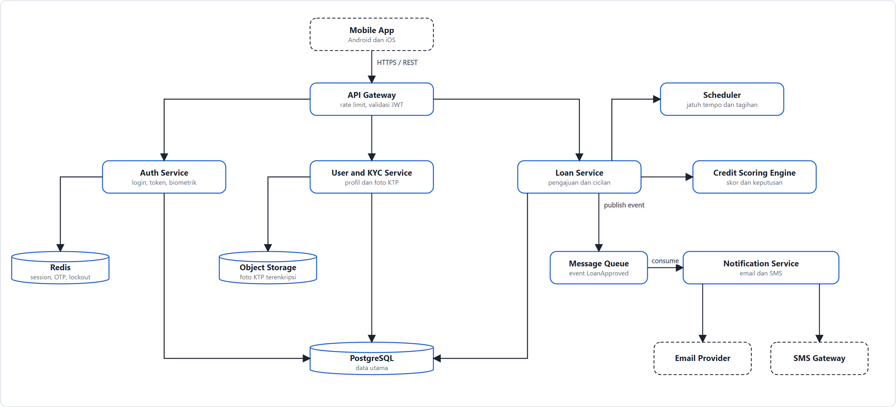

Kotak menggambarkan komponen aplikasi, silinder menggambarkan media penyimpanan data, dan kotak bergaris putus-putus menggambarkan sistem eksternal. Arah panah menunjukkan arah pemanggilan.

| Komponen | Fungsi |
|---|---|
| Mobile App (Android dan iOS) | Antarmuka pengguna, validasi input di sisi klien, autentikasi biometrik melalui sistem operasi, dan penyimpanan token pada secure storage (Keychain atau Keystore) |
| API Gateway | Terminasi TLS, validasi JWT, rate limiting, dan penerusan request ke layanan terkait |
| Auth Service | Login password dan biometrik, penerbitan access token dan refresh token, lockout akun, serta pengelolaan OTP |
| User and KYC Service | Registrasi, pengelolaan data profil, unggah dan enkripsi foto KTP, serta status verifikasi dokumen |
| Loan Service | Validasi aturan pinjaman (limit, tenor, dan pinjaman aktif), pengelolaan status pinjaman, serta ringkasan hutang dan cicilan |
| Credit Scoring Engine | Perhitungan skor kredit dan penetapan keputusan APPROVED atau REJECTED |
| Scheduler | Proses harian untuk menandai cicilan jatuh tempo atau terlambat dan mengirimkan pengingat tagihan |
| Message Queue | Penyaluran event, seperti LoanApproved, dari Loan Service ke Notification Service |
| Notification Service | Pengiriman email dan SMS berbasis template, retry apabila pengiriman gagal, serta pencatatan status pengiriman |
| PostgreSQL | Penyimpanan data utama (pengguna, pinjaman, cicilan, dan notifikasi) |
| Redis | Penyimpanan session, OTP beserta masa berlakunya, dan jumlah kegagalan login |
| Object Storage | Penyimpanan foto KTP yang telah dienkripsi |

Backend dirancang secara modular, baik sebagai microservice ringan maupun modular monolith, dan bersifat stateless sehingga dapat diskalakan secara horizontal. Basis data relasional dipilih karena data keuangan memerlukan transaksi yang memenuhi prinsip ACID. Pengiriman notifikasi dibuat asinkron agar gangguan pada penyedia email atau SMS tidak menghambat proses pengajuan pinjaman.

Aspek keamanan yang diterapkan:

- Seluruh komunikasi menggunakan HTTPS (TLS 1.2 atau lebih tinggi) disertai certificate pinning pada aplikasi (asumsi).
- Password di-hash menggunakan algoritma bcrypt atau Argon2.
- Access token memiliki masa berlaku singkat (sekitar 15 menit), sedangkan refresh token disimpan dalam bentuk hash pada tabel DEVICES.
- Foto KTP dienkripsi saat disimpan dan hanya dapat diakses melalui signed URL dengan masa berlaku singkat.
- Audit log dicatat untuk aktivitas login, pengajuan pinjaman, dan perubahan status pinjaman.
- Endpoint login, OTP, dan registrasi dibatasi dengan rate limiting pada API Gateway.

## 3. Screen Flow

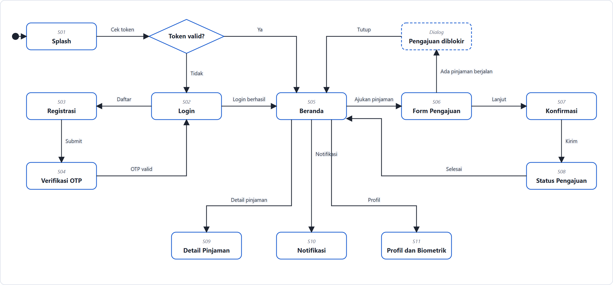

| ID | Screen | Asal | Tujuan |
|---|---|---|---|
| S01 | Splash | Aplikasi dibuka | S02 apabila belum login, S05 apabila sudah login |
| S02 | Login | S01, S04, S11 (logout) | S03, S05 |
| S03 | Registrasi | S02 | S04 |
| S04 | Verifikasi OTP | S03 | S02 |
| S05 | Beranda (sisa hutang dan tagihan) | S01, S02, S08 | S06, S09, S10, S11 |
| S06 | Form Pengajuan Pinjaman | S05, apabila tidak terdapat pinjaman berjalan | S07 |
| S07 | Konfirmasi Pengajuan | S06 | S08 |
| S08 | Status Pengajuan | S07, S10 | S05 |
| S09 | Detail Pinjaman dan Cicilan | S05, S10 | S05 |
| S10 | Notifikasi | S05 | S08, S09 |
| S11 | Profil dan Pengaturan Biometrik | S05 | S02 (logout) |
| - | Dialog "Pengajuan tidak dapat dilakukan" | S05, apabila masih terdapat pinjaman berjalan | S05 |

Ketentuan navigasi:

- Kotak menggambarkan layar, belah ketupat menggambarkan keputusan, kotak bergaris putus-putus menggambarkan dialog, dan titik hitam menandai titik awal. Label pada panah menunjukkan aksi yang memicu perpindahan layar.
- Splash menentukan layar tujuan berdasarkan token yang tersimpan. Apabila token masih valid, pengguna diarahkan ke Beranda; apabila token tidak tersedia atau telah kedaluwarsa, pengguna diarahkan ke Login.
- Tombol "Ajukan Pinjaman" pada Beranda mengikuti nilai `canApply` dari API. Apabila bernilai `false`, sistem menampilkan dialog pemblokiran, bukan form pengajuan.
- Pengajuan yang telah dikirim dari S07 tidak dapat dibatalkan. Tombol kembali pada S08 mengarahkan pengguna ke Beranda, bukan ke form pengajuan.

## 4. Entity Relationship Diagram

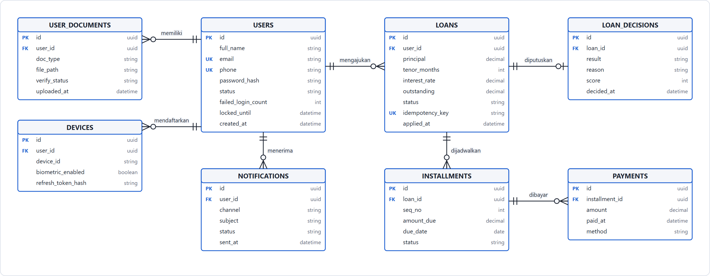

Notasi crow's foot: dua garis tegak berarti tepat satu, kaki gagak dengan lingkaran berarti nol atau banyak, dan garis dengan lingkaran berarti nol atau satu. PK adalah primary key, FK adalah foreign key, dan UK adalah unique key.

| Tabel | Keterangan |
|---|---|
| USERS | Data akun nasabah. Kolom `email` dan `phone` bersifat unik. Kolom `status` bernilai PENDING, ACTIVE, atau LOCKED. Kolom `failed_login_count` dan `locked_until` digunakan untuk mekanisme lockout |
| USER_DOCUMENTS | Dokumen KYC (foto KTP). Kolom `file_path` merujuk ke object storage, sedangkan `verify_status` bernilai PENDING, VERIFIED, atau REJECTED |
| DEVICES | Perangkat yang terdaftar untuk setiap pengguna, termasuk penanda `biometric_enabled` dan hash refresh token |
| LOANS | Data pengajuan dan pinjaman. Kolom `principal` bernilai maksimal 12.000.000, `tenor_months` bernilai 1 sampai 12, `outstanding` menyimpan sisa hutang, dan `idempotency_key` bersifat unik |
| LOAN_DECISIONS | Hasil credit scoring berupa keputusan APPROVED atau REJECTED, alasan, dan skor |
| INSTALLMENTS | Jadwal cicilan bulanan dengan status UNPAID, PAID, atau LATE |
| PAYMENTS | Data pembayaran cicilan |
| NOTIFICATIONS | Log notifikasi (EMAIL, SMS, IN_APP) dengan status SENT atau FAILED |

Satu pengguna dapat memiliki banyak dokumen, perangkat, pinjaman, dan notifikasi. Satu pinjaman memiliki paling banyak satu keputusan dan dapat memiliki banyak cicilan, sedangkan satu cicilan dapat memiliki beberapa pembayaran. Jadwal cicilan dibentuk setelah pinjaman berstatus APPROVED.

Siklus status pinjaman diawali dari SUBMITTED, kemudian PROCESSING, lalu APPROVED atau REJECTED. Pinjaman berstatus APPROVED berubah menjadi ACTIVE setelah dana dicairkan dan menjadi PAID_OFF setelah seluruh cicilan dilunasi (asumsi).

Untuk menjamin aturan FR-05 dan FR-08 juga ditegakkan pada tingkat basis data, ditambahkan constraint berikut:

```sql
ALTER TABLE loans ADD CONSTRAINT chk_principal CHECK (principal > 0 AND principal <= 12000000);
ALTER TABLE loans ADD CONSTRAINT chk_tenor CHECK (tenor_months BETWEEN 1 AND 12);

-- satu pengguna hanya boleh memiliki satu pinjaman yang masih berjalan
CREATE UNIQUE INDEX uq_loans_one_running_per_user
  ON loans (user_id)
  WHERE status IN ('SUBMITTED', 'PROCESSING', 'APPROVED', 'ACTIVE');
```

## 5. Detail Design API

Kebutuhan pada Bagian 1 diturunkan menjadi use case. Setiap use case kemudian dijabarkan ke dalam activity diagram, use case description, dan sequence diagram. CRC card dan class diagram mengintegrasikan seluruh use case tersebut.

Pada sequence diagram, lifeline dituliskan sebagai objek (misalnya `:AuthService`), dan setiap pesan menggunakan method yang didefinisikan pada class diagram di Subbagian 5.8.

| Kebutuhan | Use Case |
|---|---|
| FR-01 | UC-01 Registrasi |
| FR-02, FR-03 | UC-02 Login |
| FR-04 | UC-03 Lihat Sisa Hutang dan Tagihan |
| FR-05, FR-06, FR-08 | UC-04 Ajukan Pinjaman |
| FR-07 | UC-05 Kirim Notifikasi |

### 5.1 Use Case Diagram

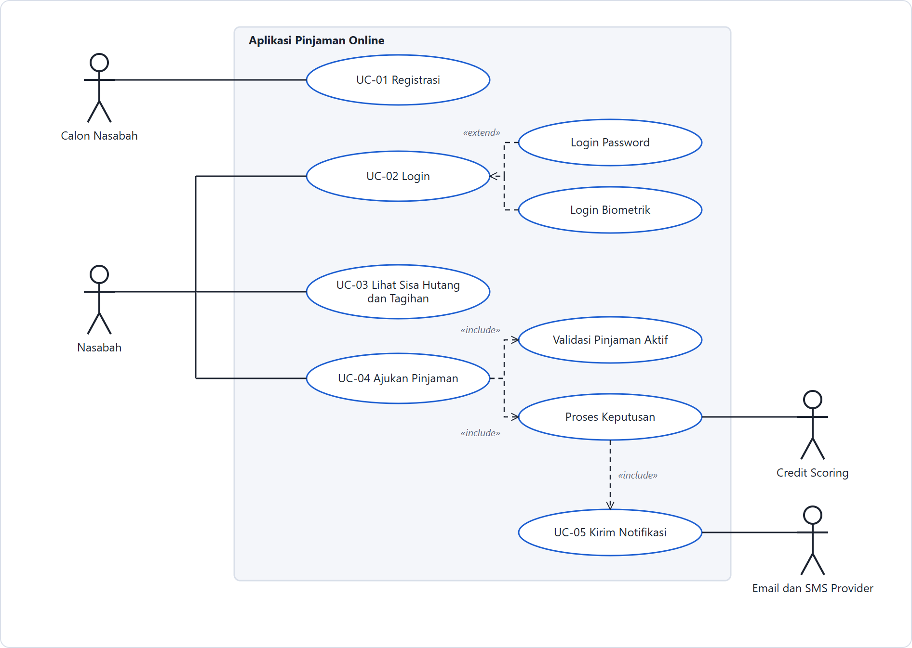

Garis lurus menggambarkan asosiasi antara aktor dan use case, sedangkan garis putus-putus menggambarkan relasi include dan extend.

### 5.2 UC-01 Registrasi

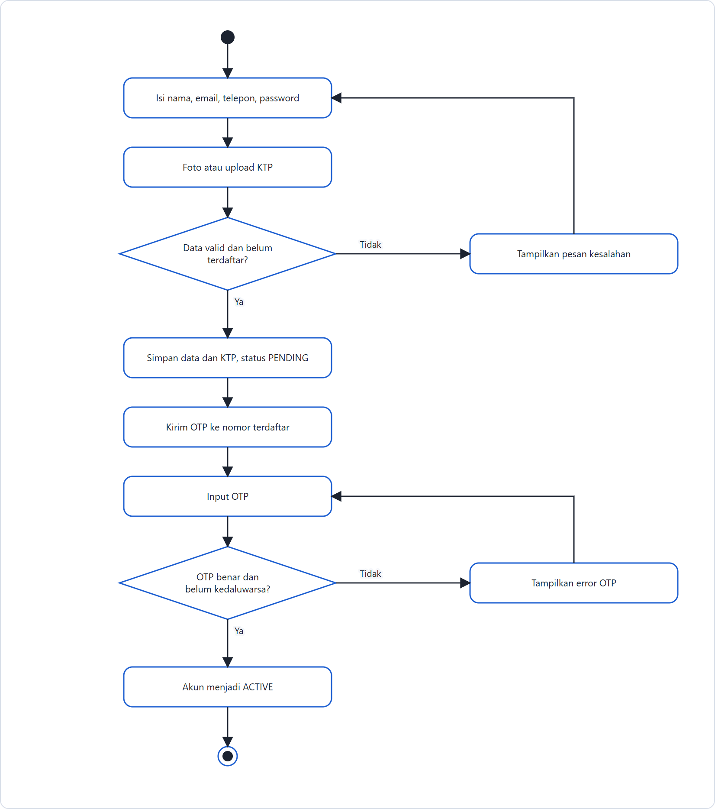

| | |
|---|---|
| Aktor | Calon Nasabah |
| Pre-condition | Aplikasi telah terpasang dan perangkat terhubung ke internet |
| Main flow | 1. Calon nasabah mengisi nama, email, nomor telepon, dan password. 2. Calon nasabah mengambil atau mengunggah foto KTP. 3. Calon nasabah mengirimkan data. 4. Sistem memvalidasi format dan keunikan data. 5. Sistem menyimpan data dan foto KTP secara terenkripsi. 6. Sistem mengirimkan OTP. 7. Calon nasabah memasukkan OTP. 8. Status akun menjadi ACTIVE. |
| Alternate / exception | Format data tidak valid: sistem menampilkan pesan kesalahan per field (422). Email atau nomor telepon telah terdaftar (409). Foto KTP tidak berformat JPG/PNG atau melebihi 5 MB (422). OTP salah atau kedaluwarsa: pengguna diminta mengirim ulang OTP. |
| Post-condition | Akun berstatus ACTIVE dan dapat digunakan untuk login |

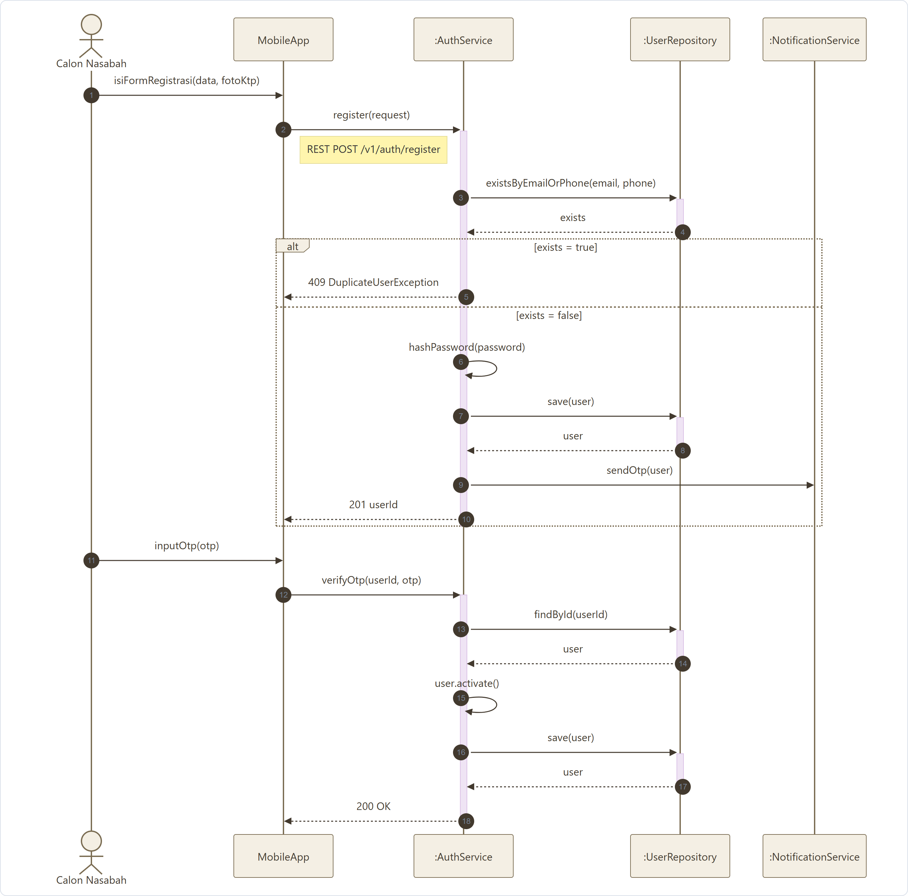

### 5.3 UC-02 Login

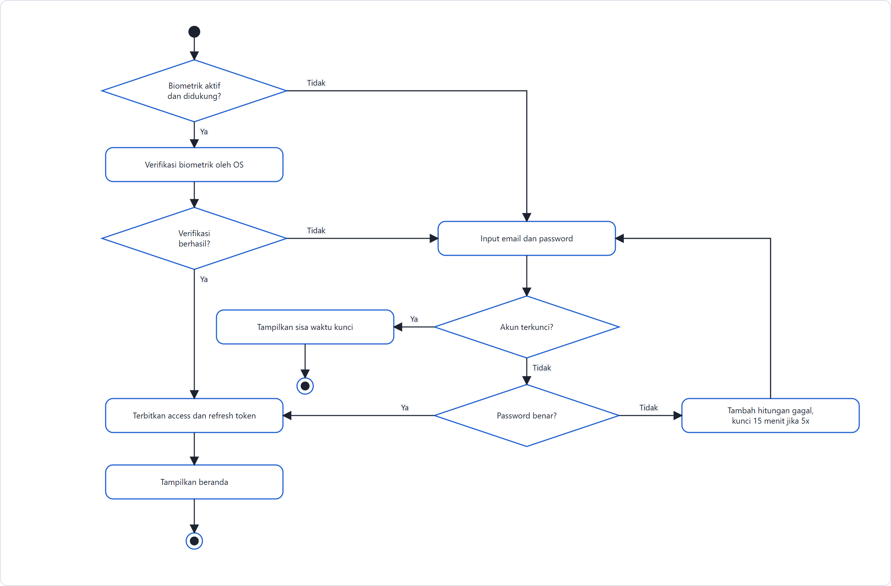

| | |
|---|---|
| Aktor | Nasabah |
| Pre-condition | Akun berstatus ACTIVE. Untuk login biometrik, perangkat mendukung biometrik dan fitur tersebut telah diaktifkan |
| Main flow | 1. Nasabah memilih metode login. 2a. Password: nasabah memasukkan email dan password, kemudian sistem mencocokkan hash password. 2b. Biometrik: sistem operasi memverifikasi biometrik, kemudian aplikasi mengirimkan deviceId dan refresh token. 3. Sistem menerbitkan token. 4. Aplikasi menampilkan Beranda. |
| Alternate / exception | Password salah: jumlah kegagalan bertambah; setelah 5 kali gagal, akun dikunci selama 15 menit (423). Biometrik gagal atau tidak tersedia: nasabah diarahkan ke login password. Token perangkat tidak valid (401). |
| Post-condition | Sesi aktif dan jumlah kegagalan login diatur ulang |

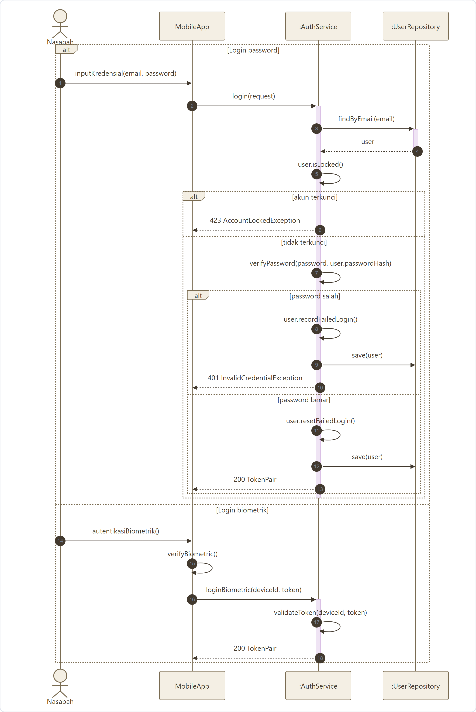

### 5.4 UC-03 Lihat Sisa Hutang dan Tagihan

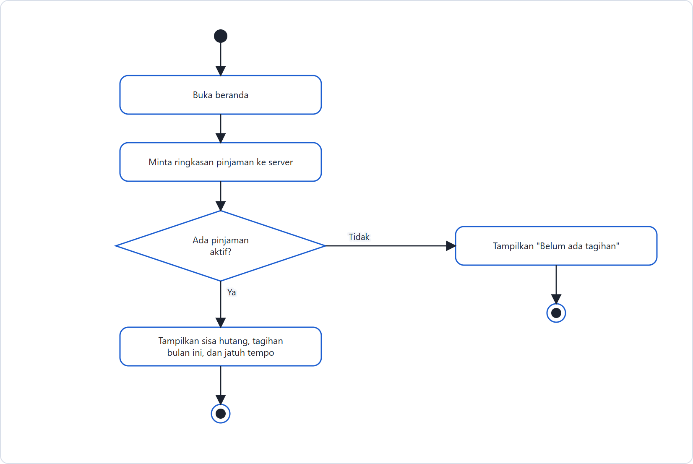

| | |
|---|---|
| Aktor | Nasabah |
| Pre-condition | Nasabah telah login |
| Main flow | 1. Nasabah membuka Beranda. 2. Sistem mengambil data sisa hutang dan cicilan yang sedang berjalan. 3. Aplikasi menampilkan sisa hutang, tagihan bulan berjalan, dan tanggal jatuh tempo. 4. Nasabah dapat membuka detail cicilan (opsional). |
| Alternate / exception | Tidak terdapat pinjaman aktif: aplikasi menampilkan "Belum ada tagihan" dan tombol pengajuan dalam keadaan aktif. Token kedaluwarsa: aplikasi memperbarui token; apabila gagal, pengguna diarahkan ke Login. |
| Post-condition | Informasi hutang ditampilkan tanpa perubahan data |

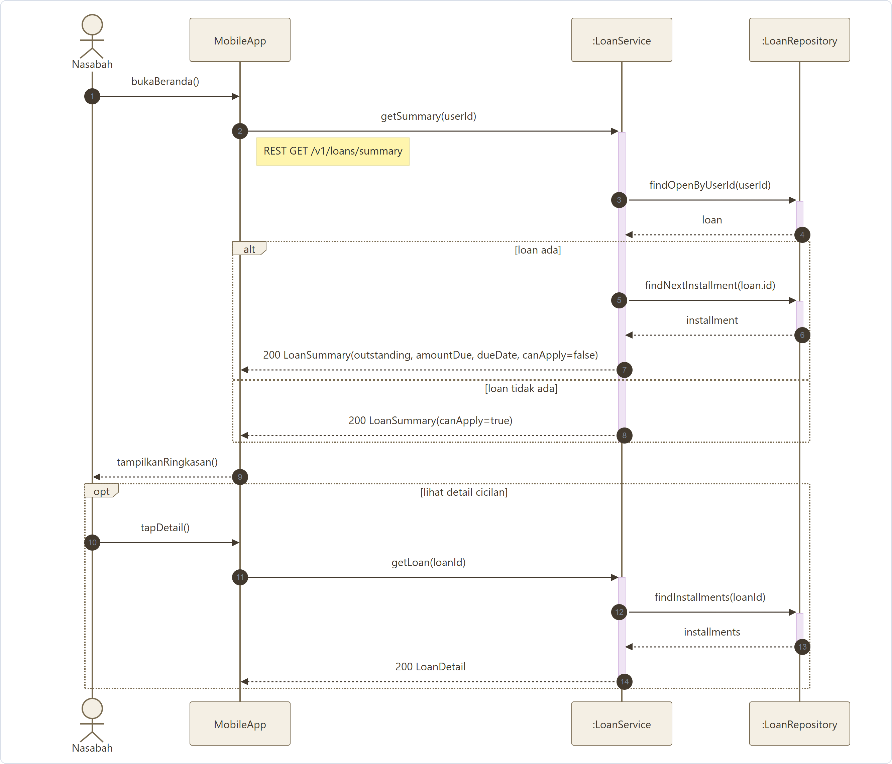

### 5.5 UC-04 Ajukan Pinjaman

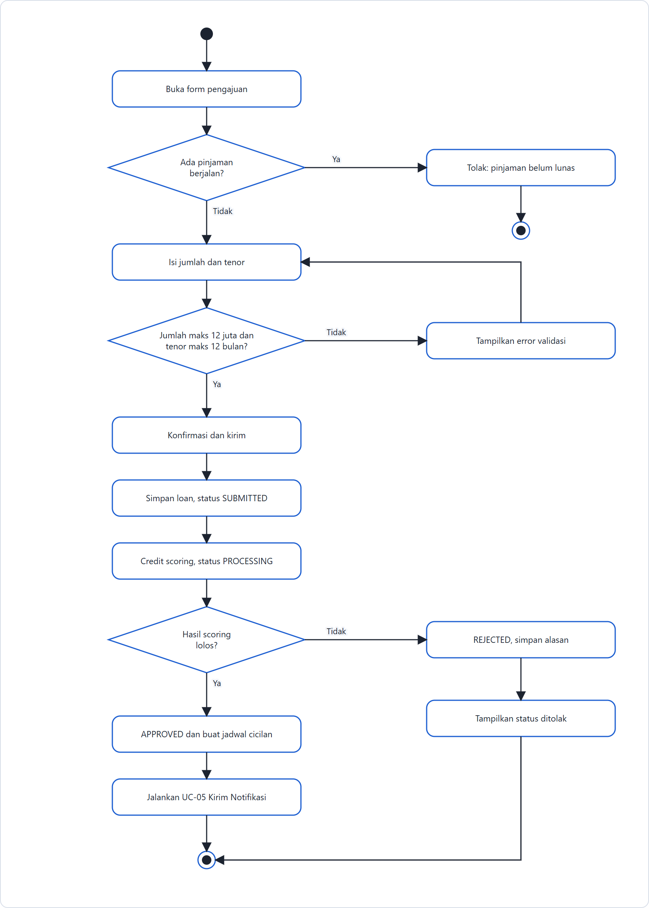

| | |
|---|---|
| Aktor | Nasabah, dengan Credit Scoring sebagai aktor sekunder |
| Pre-condition | Nasabah telah login |
| Main flow | 1. Nasabah membuka form pengajuan. 2. Sistem memastikan tidak terdapat pinjaman berjalan. 3. Nasabah mengisi jumlah pinjaman dan tenor. 4. Nasabah mengonfirmasi pengajuan. 5. Sistem menyimpan pinjaman dengan status SUBMITTED. 6. Sistem menjalankan credit scoring. 7. Status pinjaman menjadi APPROVED atau REJECTED. 8. Apabila APPROVED, sistem menjalankan UC-05. |
| Alternate / exception | Masih terdapat pinjaman berjalan (409 LOAN_ALREADY_ACTIVE). Jumlah melebihi Rp12.000.000 atau tenor melebihi 12 bulan (422). Request terkirim lebih dari satu kali: idempotency key mengembalikan hasil request pertama. Credit scoring melewati batas waktu: status tetap PROCESSING dan diperiksa ulang. |
| Post-condition | Pinjaman tercatat dengan status akhir dan keputusan tersimpan |

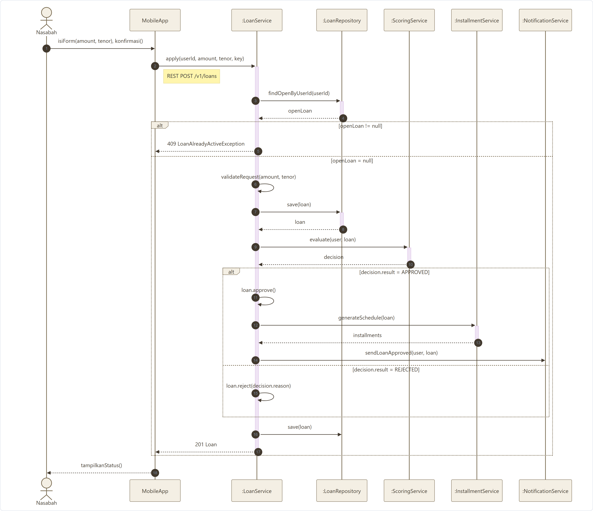

### 5.6 UC-05 Kirim Notifikasi

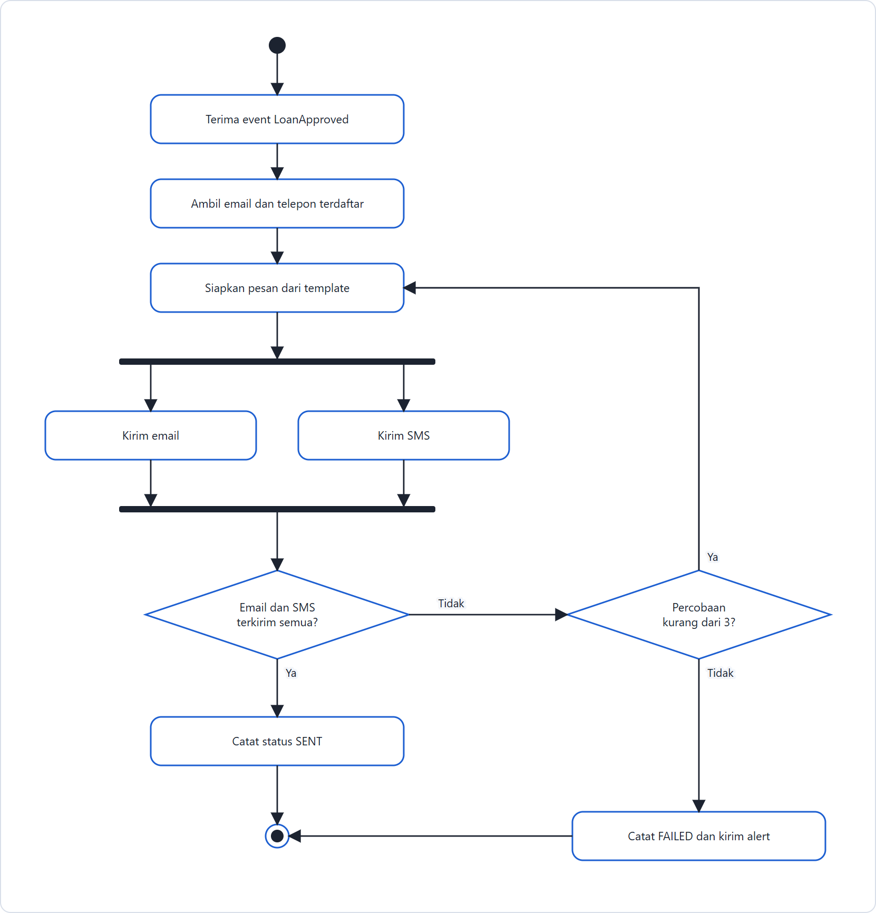

| | |
|---|---|
| Aktor | Email dan SMS Provider; dipicu secara otomatis oleh UC-04 |
| Pre-condition | Pinjaman berstatus APPROVED dan event telah tersedia pada message queue |
| Main flow | 1. Notification Service menerima event. 2. Sistem mengambil email dan nomor telepon terdaftar. 3. Sistem menyusun pesan berdasarkan template. 4. Sistem mengirimkan email dan SMS. 5. Sistem mencatat status SENT. 6. Notifikasi ditampilkan pada aplikasi. |
| Alternate / exception | Pengiriman gagal: sistem melakukan retry maksimal 3 kali dengan jeda bertahap. Apabila tetap gagal, status dicatat sebagai FAILED dan tim operasional menerima alert. Status pinjaman tetap APPROVED. |
| Post-condition | Data notifikasi tersimpan dengan status SENT atau FAILED |

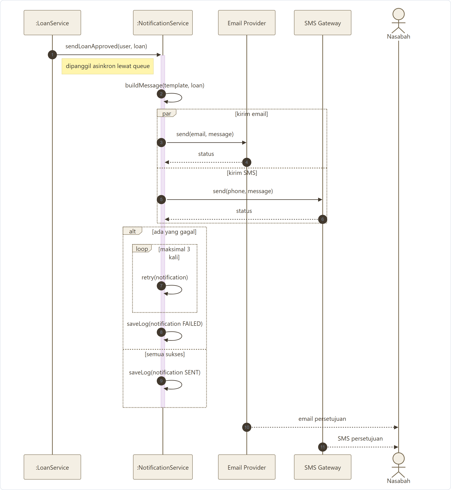

### 5.7 CRC Card

| Class | Tanggung Jawab | Kolaborator |
|---|---|---|
| AuthController | Menerima request registrasi, login, dan biometrik | AuthService |
| AuthService | Memvalidasi kredensial, menerbitkan token, dan mengelola lockout | UserRepository, TokenProvider, OtpService |
| UserService | Menyimpan profil dan KTP serta memeriksa keunikan data | UserRepository, FileStorage |
| LoanController | Menyediakan endpoint pengajuan, ringkasan, dan cicilan | LoanService |
| LoanService | Memvalidasi aturan pinjaman (limit, tenor, pinjaman aktif), menyimpan data, dan mengubah status | LoanRepository, ScoringService, EventPublisher |
| ScoringService | Menghitung skor dan menetapkan keputusan | Loan, User |
| InstallmentService | Membentuk jadwal cicilan dan menghitung sisa hutang | Loan, Installment |
| NotificationService | Mengirim email dan SMS, melakukan retry, dan mencatat status | EmailGateway, SmsGateway, Notification |

### 5.8 Class Diagram

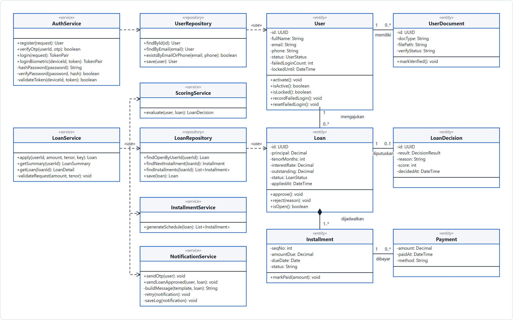

Notasi: `+` menandai public, `-` menandai private, garis putus-putus dengan panah terbuka menggambarkan dependency («use»), belah ketupat hitam menggambarkan komposisi, dan angka pada ujung garis menunjukkan multiplicity.

### 5.9 Daftar Endpoint

Seluruh endpoint menggunakan base path `/v1`. Kecuali endpoint register, verify-otp, resend-otp, login, refresh, dan biometric/login, setiap request wajib menyertakan header `Authorization: Bearer <accessToken>`.

| Endpoint | Request | Response |
|---|---|---|
| `POST /v1/auth/register` | multipart: fullName, email, phone, password, ktpImage | 201 userId; 409 data duplikat; 422 validasi gagal |
| `POST /v1/auth/verify-otp` | userId, otp | 200; 400 OTP salah atau kedaluwarsa |
| `POST /v1/auth/resend-otp` (asumsi) | userId | 202; 429 permintaan terlalu sering |
| `POST /v1/auth/login` | email, password, deviceId | 200 accessToken dan refreshToken; 401; 423 akun terkunci |
| `POST /v1/auth/refresh` (asumsi) | deviceId, refreshToken | 200 token baru; 401 |
| `POST /v1/auth/biometric/enable` | deviceId | 200 |
| `POST /v1/auth/biometric/login` | deviceId, refreshToken | 200 token baru; 401 |
| `POST /v1/auth/logout` (asumsi) | deviceId | 204 |
| `GET /v1/loans/summary` | - | 200 outstanding, tagihan bulan berjalan, dueDate, canApply |
| `POST /v1/loans` | amount (maksimal 12000000), tenorMonths (1 sampai 12), header Idempotency-Key | 201 loanId dan status; 409 LOAN_ALREADY_ACTIVE; 422 |
| `GET /v1/loans/{id}` | - | 200 status, keputusan, dan daftar cicilan; 404 |
| `GET /v1/notifications` | page, size | 200 daftar notifikasi |

Contoh response `GET /v1/loans/summary` untuk nasabah dengan pinjaman aktif:

```json
{
  "activeLoan": {
    "loanId": "3f1c2a9e-0000-4000-8000-000000000001",
    "status": "ACTIVE",
    "outstanding": 8000000,
    "currentBill": 1050000,
    "dueDate": "2026-12-05",
    "overdue": false
  },
  "canApply": false,
  "blockReason": "LOAN_ALREADY_ACTIVE"
}
```

Seluruh endpoint menggunakan format error yang seragam:

```json
{ "code": "LOAN_ALREADY_ACTIVE", "message": "Masih ada pinjaman yang belum lunas", "details": [] }
```

Ketentuan tambahan:

- Header `Idempotency-Key` (UUID) wajib disertakan pada `POST /v1/loans`. Request yang diulang dengan key yang sama akan menerima hasil request pertama tanpa membuat pinjaman baru.
- Nominal uang dikirim sebagai bilangan bulat dalam satuan rupiah untuk menghindari kesalahan pembulatan desimal.
- Waktu menggunakan format ISO 8601 (UTC), sedangkan tanggal jatuh tempo menggunakan format `YYYY-MM-DD`.

## 6. Screen Behavior

| Screen | Perilaku | Validasi dan Penanganan Error |
|---|---|---|
| S01 Splash | Memeriksa token yang tersimpan. Apabila valid, pengguna diarahkan ke S05 (dengan verifikasi biometrik apabila aktif); apabila tidak, pengguna diarahkan ke S02 | Tidak ada koneksi: menampilkan pesan "Periksa koneksi" |
| S02 Login | Input email dan password. Tombol "Masuk dengan biometrik" hanya ditampilkan apabila perangkat mendukung dan fitur telah diaktifkan. Tersedia tautan ke S03 | Field kosong: tombol nonaktif. 401: "Email atau password salah". 423: menampilkan sisa waktu penguncian |
| S03 Registrasi | Input nama, email, nomor telepon, password, dan foto KTP (kamera atau galeri) dengan pratinjau, kemudian dikirim ke S04 | Format email dan nomor telepon (+62 atau 08), password minimal 8 karakter, foto KTP wajib. 409 ditampilkan pada field yang duplikat |
| S04 OTP | Input 6 digit dengan timer 60 detik; tombol kirim ulang aktif setelah timer habis. Apabila berhasil, pengguna diarahkan ke S02 | OTP salah: menampilkan pesan kesalahan. Setelah 3 kali salah, pengguna diminta mengirim ulang OTP |
| S05 Beranda | Kartu sisa hutang dan tagihan bulan berjalan beserta tanggal jatuh tempo. Tombol "Ajukan Pinjaman" nonaktif apabila terdapat pinjaman berjalan, disertai keterangan alasannya | Tidak terdapat pinjaman: menampilkan "Belum ada tagihan" |
| S06 Form Pengajuan | Slider atau input jumlah (maksimal Rp12.000.000), pilihan tenor 1 sampai 12 bulan, dan simulasi cicilan otomatis | Jumlah atau tenor melebihi batas: pesan kesalahan pada field. 409 dari server: menampilkan dialog pemblokiran |
| S07 Konfirmasi | Ringkasan pinjaman, cicilan per bulan, dan checkbox persetujuan. Tombol kirim langsung dinonaktifkan setelah ditekan untuk mencegah pengiriman ganda | Checkbox persetujuan wajib dicentang |
| S08 Status | Indikator proses selama status PROCESSING. Hasil APPROVED disertai informasi pengiriman notifikasi email dan SMS; hasil REJECTED disertai alasan umum | Batas waktu terlampaui: menampilkan "Pengajuan sedang diproses, silakan periksa kembali nanti" |
| S09 Detail Pinjaman | Daftar cicilan dengan status belum dibayar, lunas, atau terlambat | - |
| S10 Notifikasi | Daftar notifikasi; pemilihan notifikasi membuka S08 atau S09 | - |
| S11 Profil | Toggle biometrik (disembunyikan apabila perangkat tidak mendukung) dan logout | Aktivasi biometrik memerlukan autentikasi sistem operasi |

Rincian perilaku setiap screen:

**S01 Splash.** Saat aplikasi dibuka, token dibaca dari secure storage. Apabila token tersedia dan biometrik aktif, aplikasi meminta verifikasi biometrik, kemudian memanggil `POST /v1/auth/biometric/login`. Apabila token tersedia tetapi biometrik tidak aktif, aplikasi memanggil `POST /v1/auth/refresh`. Jika berhasil, pengguna diarahkan ke Beranda; jika gagal, pengguna diarahkan ke Login.

**S02 Login.** Tombol Masuk memanggil `POST /v1/auth/login`. Jika berhasil, token disimpan dan pengguna diarahkan ke Beranda. Apabila perangkat mendukung biometrik dan fitur tersebut belum diaktifkan, aplikasi menawarkan aktivasi sebanyak satu kali. Untuk error 423, sisa waktu penguncian ditampilkan dalam bentuk hitung mundur.

**S03 Registrasi.** Validasi di sisi aplikasi meliputi format email, nomor telepon berawalan +62 atau 08 dengan panjang 10 sampai 14 digit, password minimal 8 karakter, serta foto KTP berformat JPG/PNG dengan ukuran maksimal 5 MB (dikompresi terlebih dahulu apabila melebihi batas). Pengiriman data memanggil `POST /v1/auth/register`, kemudian `userId` diteruskan ke S04.

**S04 Verifikasi OTP.** OTP dapat terisi secara otomatis dari SMS apabila didukung oleh sistem operasi. Setelah digit keenam terisi, aplikasi langsung memanggil `POST /v1/auth/verify-otp`. Tombol kirim ulang memanggil `POST /v1/auth/resend-otp` dan mengatur ulang timer.

**S05 Beranda.** Data diambil dari `GET /v1/loans/summary` setiap kali halaman dibuka atau dimuat ulang. Label "Terlambat" ditampilkan apabila cicilan telah melewati tanggal jatuh tempo. Apabila `canApply` bernilai `false`, tombol pengajuan tetap ditampilkan dalam keadaan nonaktif beserta keterangan, misalnya "Pengajuan sedang diproses" atau "Selesaikan pinjaman berjalan".

**S06 Form Pengajuan.** Jumlah pinjaman berkisar antara Rp1.000.000 (asumsi) hingga Rp12.000.000 dengan kelipatan Rp100.000. Simulasi cicilan dihitung di aplikasi berdasarkan suku bunga yang diberikan server dan bersifat perkiraan. Pada layar ini aplikasi membentuk `Idempotency-Key` dan menyimpannya hingga proses pengajuan selesai.

**S07 Konfirmasi.** Tombol kirim memanggil `POST /v1/loans` dengan `Idempotency-Key`. Apabila koneksi terputus dan pengguna mengirim ulang, key yang digunakan tetap sama. Error 409 menampilkan dialog pemblokiran lalu mengarahkan pengguna ke Beranda, sedangkan error 422 mengarahkan pengguna kembali ke S06.

**S08 Status Pengajuan.** Selama status masih PROCESSING, aplikasi memeriksa `GET /v1/loans/{id}` setiap 3 detik dengan batas waktu 30 detik. Alasan penolakan yang ditampilkan hanya berupa alasan umum; rincian hasil scoring tidak ditampilkan kepada nasabah.

**S09 Detail Pinjaman.** Data diambil dari `GET /v1/loans/{id}` dan mencakup jumlah pinjaman, tenor, sisa hutang, serta daftar cicilan (nomor cicilan, jumlah, tanggal jatuh tempo, dan status).

**S10 Notifikasi.** Data diambil dari `GET /v1/notifications` dengan paginasi. Notifikasi keputusan membuka S08, sedangkan notifikasi tagihan membuka S09.

**S11 Profil.** Nama, email, dan nomor telepon ditampilkan tanpa dapat diubah. Aktivasi biometrik memerlukan autentikasi sistem operasi, kemudian memanggil `POST /v1/auth/biometric/enable`. Logout memanggil `POST /v1/auth/logout`, menghapus token dari perangkat, lalu mengarahkan pengguna ke Login.
